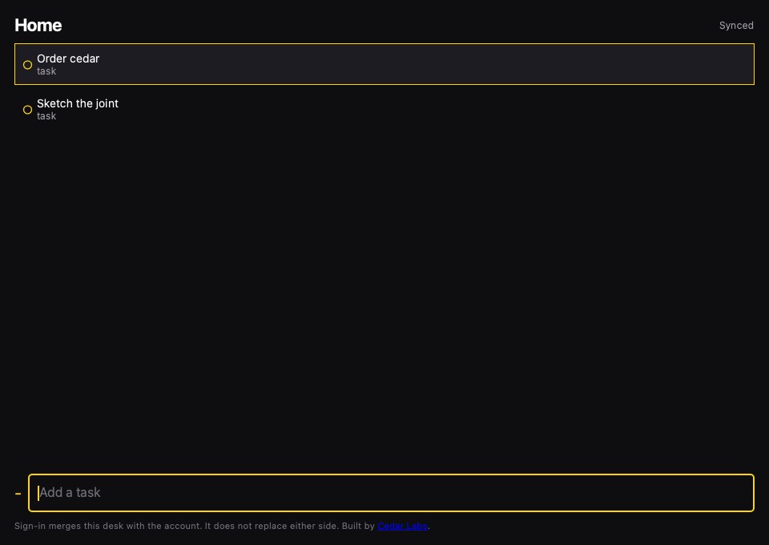

# Builder Launcher for Omarchy



A keyboard desk for the same account as the Android app and the page at
https://builder.cdr.xyz. Sign-in merges this desk with the account. It does
not replace either side. App search and the home-screen launcher stay on the
phone. Text and calls do too.

## Install

This is the Omarchy desk, not the Android app. The phone install is Obtainium, documented in the repo README. This one is an Arch package.

```sh
git clone https://github.com/cdrxyz/builder-launcher.git
cd builder-launcher/omarchy
./bin/install
```

If you already have the repo, `git pull` first, then run the same `cd` and `./bin/install`.

`bin/install` builds with `qmake6`, packages with `makepkg -fsi`, and adds **Builder Launcher** to the app launcher. Open it with Super + Space.

If `qmake6` is missing, install the set Omarchy already ships for its own apps, then run the install again:

```sh
omarchy-pkg-add base-devel qt6-base qt6-declarative qt6-multimedia qt6-svg qt6-wayland ffmpeg
./bin/install
```

To try it without installing the package:

```sh
./bin/build
./build/builder-launcher
```

`./bin/test` checks the account merge against the web client's rules, plus tasks, alarms, and the theme fallback.

After a later `git pull`, run `./bin/install` again. Sign in from Settings with the same account as the phone. Sign-in merges this desk with the account. It does not replace either side.

## Keys

| Key | Action |
| --- | --- |
| Enter | Submit the command bar. With an empty bar, open or play the selection |
| Tab | Cycle the prompt: task, note, stock, ask, slash, search |
| `-` `+` `$` `?` `/` | Type the prefix at the start of the bar to switch mode, same as the phone |
| `-` | Add a task. On Clock, a time such as `weekdays 7:30` saves an alarm |
| `+` | New note |
| `$` | Add a symbol |
| `?` | Ask, once Include AI credentials is on |
| `/` | Open a page: tasks, notes, podcasts, articles, videos, weather, clock, settings. A unique prefix is enough |
| Up / Down | Move the selection |
| Space | Toggle the selected task or alarm when the bar is empty |
| Delete | Delete the selected row when the bar is empty |
| Ctrl+Z / Ctrl+Shift+Z | Undo / redo a local edit |
| Ctrl+/ | Shortcuts |
| Ctrl+Q | Quit. Asks first when a sync is still waiting |
| Esc | Close the quit dialog, then the shortcuts. In a note, return to the list. Otherwise go home |

`?` in the command bar asks. Ctrl+/ shows the shortcuts. On articles, `1` opens the first article. On videos, paste a YouTube link. The saved id matches the phone (`v` plus the video id). Podcast episodes use the same `showId` as the phone, so a show synced from the phone opens here.

## Account

Settings keeps Sign in next to Sign out. Create account appears only while the
invite code matches. Otherwise the same control joins the waitlist. A saved
email is not treated as a live session. Logout revokes the refresh token.

Sync waits 2 seconds after an ordinary edit, 5 seconds after a reorder, and
8 seconds after a note keystroke. Podcast episode files stay on this desk.
The playhead is written about every 10 seconds, and the next play continues
from that place, the same way the page does. The account copy keeps shows
and progress.

Built by [Cedar Labs](https://cdr.xyz).
