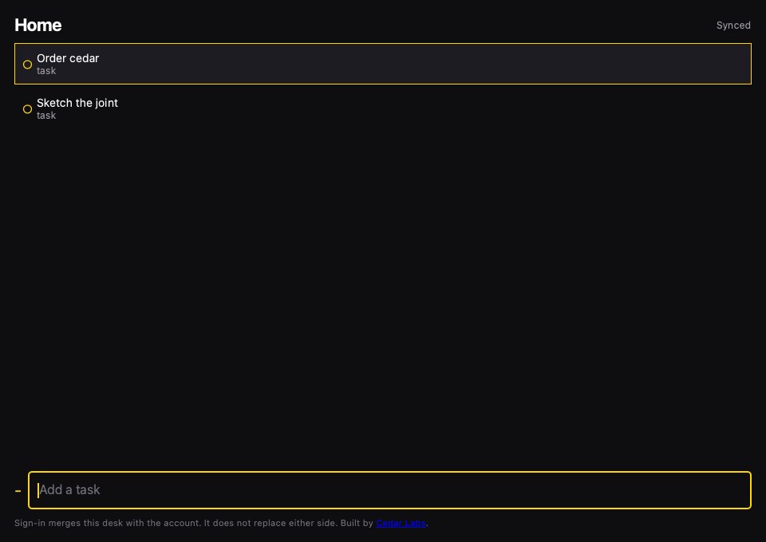

The Omarchy app is a keyboard desk for the same account as the phone and the page at [builder.cdr.xyz](https://builder.cdr.xyz). It is not the Android launcher. App search, text, and calls stay on the phone.

Sign-in merges this desk with the account. It does not replace either side.

## Install

```sh
git clone https://github.com/cdrxyz/builder-launcher.git
cd builder-launcher/omarchy
./bin/install
```

If you already have the repo, `git pull` first, then run the same `cd` and `./bin/install`.

`bin/install` builds with `qmake6`, packages with `makepkg -fsi`, and adds **Builder Launcher** to the app launcher. Open it with Super + Space.

If `qmake6` is missing, install the set Omarchy already ships for its own apps, then run the install again:

```sh
omarchy-pkg-add base-devel qt6-base qt6-declarative qt6-multimedia qt6-svg qt6-wayland ffmpeg
./bin/install
```

To try it without installing the package:

```sh
./bin/build
./build/builder-launcher
```

After a later `git pull`, run `./bin/install` again.

## Sign in

Open **Settings**. Sign in with the same email as the phone. Create account appears only while the invite code matches. Otherwise that control joins the waitlist.

Turn on **Include AI credentials** before `?` can use a synced key. A home Hermes box on the LAN stays on the phone.

