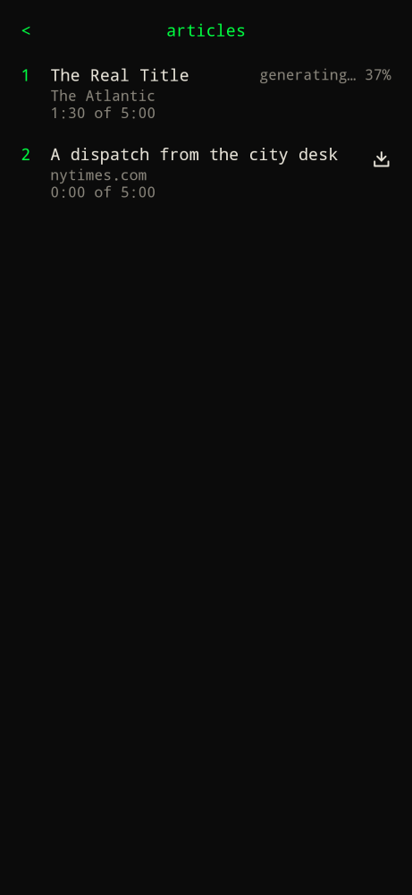
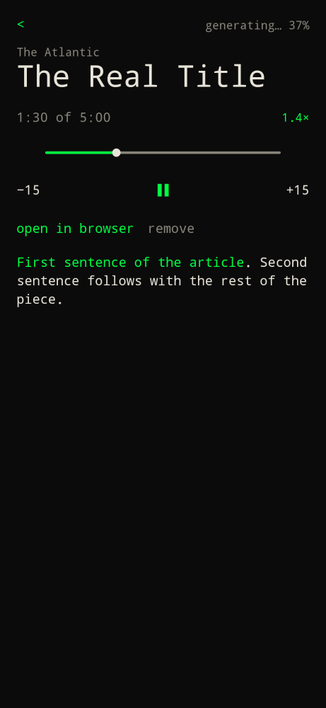

Type `articles` or `/articles`.

The bar takes a URL. Enter adds it to the top of the list and keeps the title and publication. Each row shows where you are in the spoken article, the same way a podcast episode shows position of length (`1:30 of 5:00`).

Type `1` to open the first article.

The player has the title, play and skip controls, the article text, and **open in browser**. The article text and the playback position are in the account snapshot and in an S3 backup, so a phone and the web app pick up the same place.

The web app fetches the page through `/api/articles` on the same host, because article sites do not allow a browser to read them directly. The phone fetches the page itself. Private and non-http links are refused.
