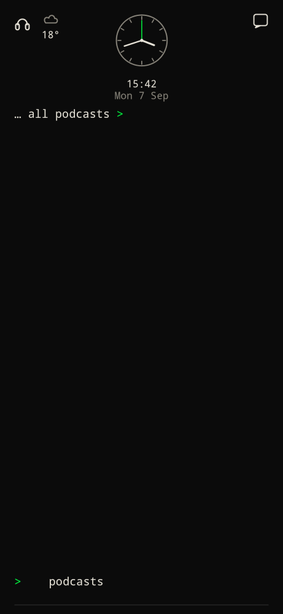
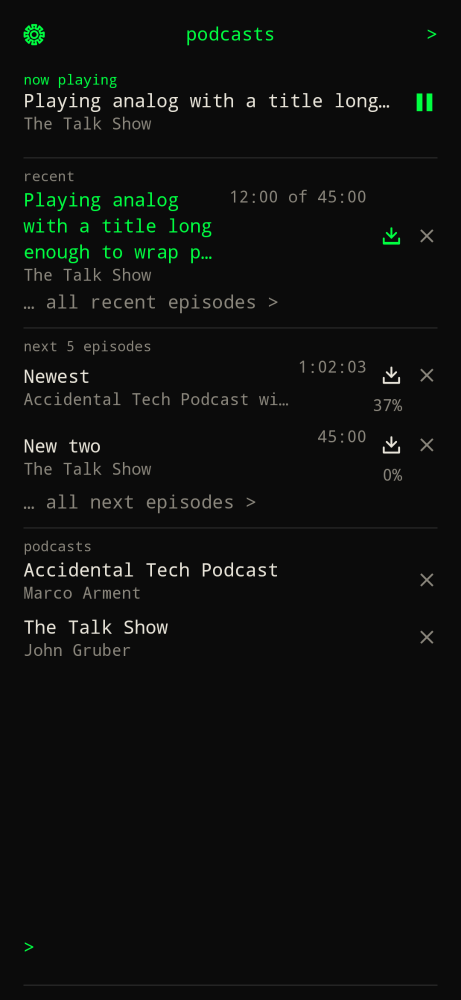
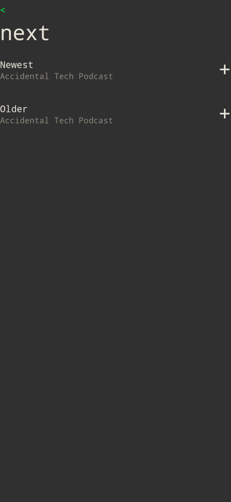
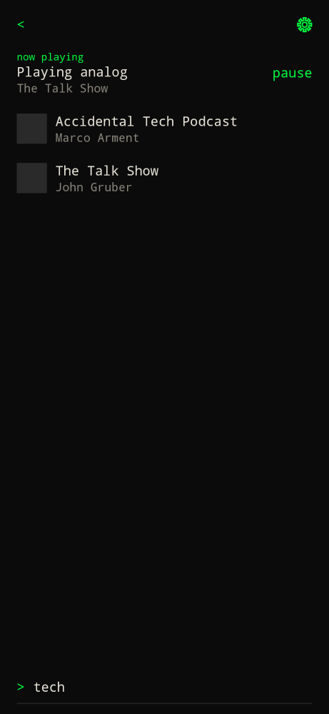
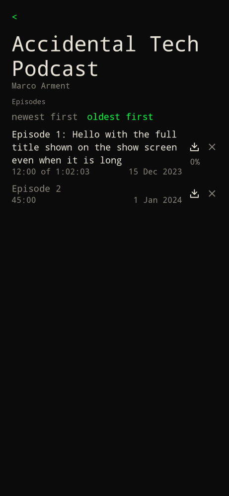
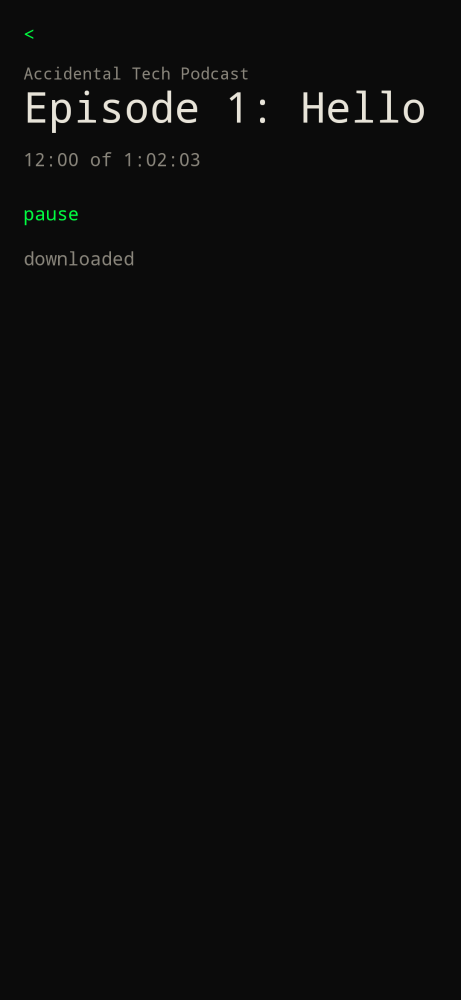
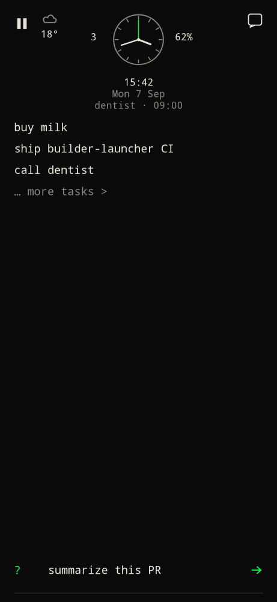
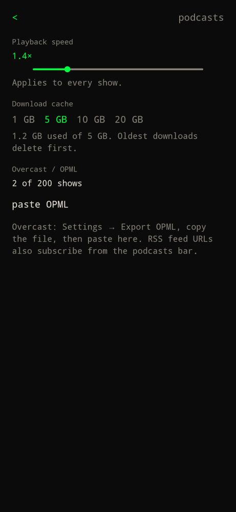

Type `podcasts`, `/podcasts`, tap the headphones mark at the top left of [home](home/), swipe from the left of home, press D-pad left, or tap `… all podcasts >`.

There is no live Overcast account sync. Export OPML from Overcast (Settings → Export OPML), copy it, and paste on podcasts settings. The same subscriptions, episodes, and playback position are in the [web app](../../configure/web/) when you use the S3 backup.

## Home list

Order:

1. **now playing** bar under gear/`>` when an episode is loaded and not finished. Tap the title for the episode screen. Play/pause icons on the right. The bar stays up while you search. A playing saved article uses the same bar, titled with the article and Saved Articles. Tap it to open that article's player.
2. **recent** — up to 3 unfinished plays or episodes added with +, most recently touched, excluding the current episode. Tap to play without leaving the list. The position sits at the top of the row. Download sits beside ×, and the percent sits under the icon while a file is fetching, so it does not crowd the position. × dismisses it (skipped, reversible) and deletes its download. The dismiss is kept across sync, so it stays out of recent, next, and autoplay. `… all recent episodes >` opens every recent episode, with a download on each row.
3. **next 5 episodes** — newest episodes that are not finished or skipped. Titles wrap to 3 lines. Show names stay on one line. Tap to play. The length sits at the top of the row. Download sits beside ×. Tap several downloads to queue them; each shows 0% under the icon until that file starts, then percent while it fetches. One file downloads at a time. × skips that episode, deletes its download, and leaves it out of this list and out of what plays next. `… all next episodes >` opens every episode, newest first, with + to add one to recent.

4. **podcasts** — every subscription, A–Z. An × on the right unsubscribes, same as notes and todos.

Empty list: `Type a show name, RSS URL, or paste Overcast OPML.`

- Type a show name to search the Apple podcast catalog. Hits show artwork on the left. Tap a hit to subscribe and open that show. On [the web app](../../configure/web/) the browser talks to Apple directly (CORS is open). Cloudflare Workers are rate-limited to `itunes.apple.com`, so `/api/podcasts/search` is a fyyd.de fallback. RSS subscribe still goes through the Worker.
- Paste an RSS URL in the bar to subscribe.
- Gear (top left) opens podcasts settings.
- Title `podcasts` is centered at the top.
- `>` (top right) returns home.

## Show

Open a subscription. The show title scrolls with the episode list — it is not pinned — so a long name does not cover the list on a short screen or with the keyboard up. Episode titles are shown in full. Length (or resume position) sits under the title on the left; the publish date sits on the right. Skipped and played episodes are grey. Tap a skipped title to restore it. Tap a played title to open it again. The download icon sits beside × — outline if not downloaded, filled if it is. Tap several episodes to queue downloads. Each shows 0% under the icon until that file starts, then percent while it fetches, so the percent does not sit on the position line. One file downloads at a time. × skips or restores. A skip deletes the download and stays skipped after sync, so the episode leaves next and is not what plays next. Episodes default to **newest first**. Switch to **oldest first** on that show if you want to listen from the beginning. The choice is saved per show and also sets which episode plays next when the current one finishes. Unsubscribe from the podcasts list.

## Episode

- Play/pause icons stream the enclosure, or the downloaded file when it exists. The show name and episode title scroll with the player and show notes. They are not pinned, so a long title can move off a short screen or when the keyboard is up.
- A download icon sits at the top right. Outline if not downloaded, filled if it is. Percent shows 0% as soon as the episode is queued, then the fetch percent. Queued files wait until the active download finishes. Finished and dismissed episodes delete their download.
- Drag the progress bar. It sits inset from the screen edges so a side back gesture is not triggered. **−15** / **+15** skip 15 seconds. The [web app](../../configure/web/) uses the same layout.
- Speed sits to the right of `12:00 of 1:02:03`. Tap it for 0.8×, 1×, 1.1×, 1.2×, 1.4×, 1.6×, 1.8×, 2×, 2.5×, 3×. That choice is the default for every show.
- Position is saved every 30 seconds while playing, and again on pause, seek, or stop. Play again resumes where you left off after a crash or update. Near the end counts as finished and hides the now playing bar. The next episode in that show then starts, following **newest first** or **oldest first**. Finished and skipped episodes are left out. If nothing is left, playback stops.
- **Show notes** from the feed sit under the player. Timestamps (`0:00`, `12:34`, `1:02:03`) are links; tap one to jump there.

While audio is playing, a pause icon sits at the top left of home; tap it to pause. After pause it becomes play, then after 8 seconds the headphones mark again. Headphones is always there otherwise — tap it for podcasts. While a saved article is playing, that mark controls the article instead. Weather sits to the right of that mark. Lock screen, Bluetooth, and Android media controls use the Builder Launcher mark as the app icon. A playing article uses the same controls, titled with the article and the show Saved Articles. Back and forward skip 15 seconds. Play/pause still pauses. Tap the mark, the media card, or the notification to open the now playing episode in the launcher. The web app has the same × on recent, next, the full catalogs, and each show’s episode list. A skipped row’s × restores it.

Search uses Apple's iTunes podcast catalog (not Overcast). Type a show name on the podcasts screen. Overcast is only for OPML import.

## Settings

Tap the gear on the podcasts list.

**Playback speed:** 0.8×, 1×, 1.1×, 1.2×, 1.4×, 1.6×, 1.8×, 2×, 2.5×, 3×. Default 1×. Applies to every show, including the episode that is playing.

**Skip silence:** `on` (default) or `off`. Skips pauses while people think. Voices stay at the same speed. Applies to every show, including the episode that is playing.

**Download cache:** `1 GB` / `5 GB` (default) / `10 GB` / `20 GB`. Oldest downloads delete first when the cap is exceeded. The episode that is playing is kept. Played and dismissed episodes are removed from the cache.

**paste OPML:** Overcast export, or any OPML with `xmlUrl` RSS outlines. Feeds are ordinary RSS with enclosures.
